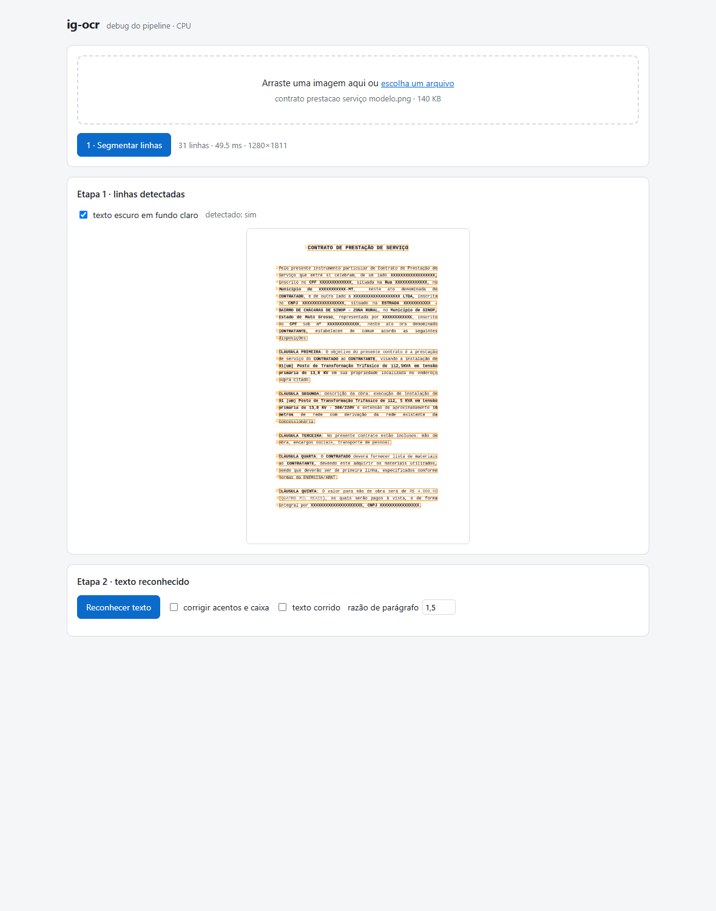
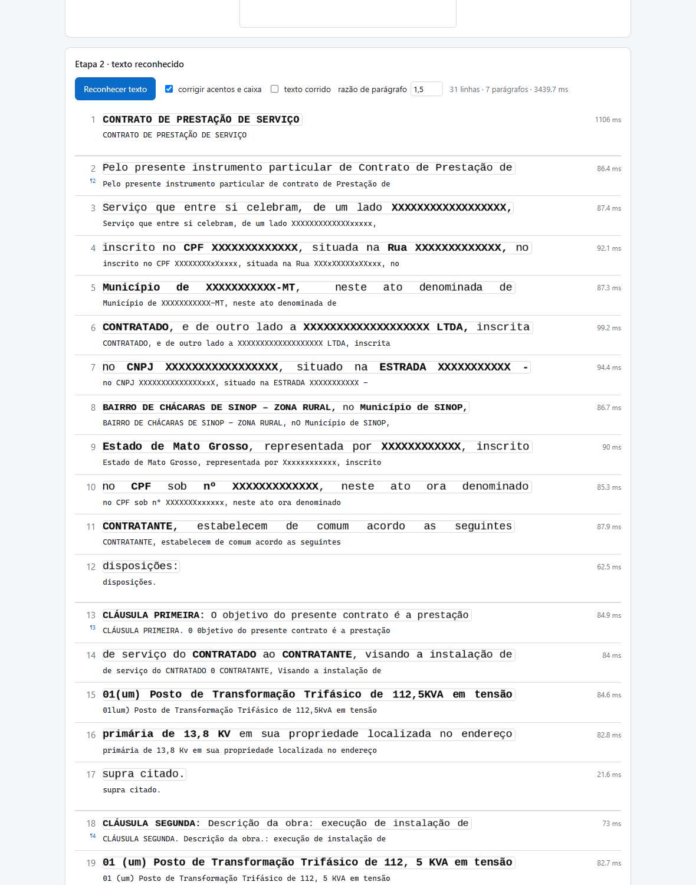

# ig-ocr

OCR de linha para documentos em português, escrito como projeto de estudo. Um
CRNN com CTC lê a página inteira, linha por linha, e o texto passa por um
corretor léxico opcional (acento e caixa) construído sobre o corpus
[floresta](https://www.linguateca.pt/floresta/).

Os pesos não vão para o git: gere o dataset, treine e passe o nome do seu
checkpoint nos comandos. Um treino completo neste repositório fica em torno de
98% de exact match no split sintético de teste.

## Estrutura

```
src/
├── ocr/          runtime: modelo, segmentação de linhas, inferência, pós-processamento
│   ├── model.py          CRNN, alfabeto, dataset (shards webdataset)
│   ├── analyzer.py       página -> linhas (threshold Otsu + componentes conexos)
│   ├── recognize.py      página -> texto
│   └── postprocess.py    corretor léxico (acentos e caixa) para português real
├── training/     treino e medição
│   ├── train.py
│   ├── evaluate.py
│   └── compare_font_errors.py   relatório de erro por fonte
├── datagen/      geração do dataset sintético
│   ├── generator.py      shards de linhas de palavras (trdg) + linhas de páginas
│   └── page_generator.py páginas completas (margens, parágrafos, campos, ruído)
├── web/          tela local de debug (FastAPI)
│   ├── app.py            upload -> linhas -> texto, servidor em 127.0.0.1:8000
│   └── static/index.html frontend sem build
└── utils/paths.py
```

O pipeline é: `page_generator`/`generator` escrevem shards em
`data/raw/words-dataset` → `train` ajusta o CRNN → `recognize` usa
`analyzer` para cortar as linhas e `postprocess` para corrigir o texto.
Os diagramas das duas etapas estão em [`docs/data-flow.md`](docs/data-flow.md).

## Ambiente

```powershell
# na primeira vez, com o Python do sistema:
py -3 -m venv .venv
.venv\Scripts\python.exe -m pip install -r requirements.txt
```

Rode tudo da raiz do repositório, sempre pelo interpretador do `.venv`.

## Uso

Reconhecer uma página (a imagem deve estar em `data/test_images/`):

```powershell
.venv\Scripts\python.exe -m src.ocr.recognize 11263 meu-modelo
.venv\Scripts\python.exe -m src.ocr.recognize 11263 meu-modelo --postprocess
```

O checkpoint é obrigatório: é o nome do arquivo em
`artifacts/checkpoints/ocr/`, sem o `.pth`.

Se existir um `.json` de mesmo nome ao lado da imagem (formato do
`page_generator`: `{"clues": [{"text": ..., "bbox": {...}}]}`), o comando
compara o resultado com o gabarito e imprime a acurácia de caractere. Sem JSON,
imprime apenas o texto.

As linhas são agrupadas em parágrafos pelo ritmo vertical da página (a distância
entre linhas consecutivas contra o passo normal da página). O texto sai com uma
linha em branco entre parágrafos; `--flow` junta as linhas de um parágrafo em
texto corrido, e `--para-ratio` ajusta o quanto um espaço precisa ser maior que
o passo normal para abrir parágrafo (padrão `1.5`):

```powershell
.venv\Scripts\python.exe -m src.ocr.recognize 11263 meu-modelo --flow
.venv\Scripts\python.exe -m src.ocr.recognize 11263 meu-modelo --para-ratio 1.8
```

A segmentação descarta o que não é texto (moldura, régua fina, caixa quase sem
tinta) e separa duas linhas fundidas. `--debug` lista cada caixa descartada com
o motivo (`frame`, `thin`, `empty`):

```powershell
.venv\Scripts\python.exe -m src.ocr.recognize 11263 meu-modelo --debug
```

### Tela de debug

Sobe um servidor local (só `127.0.0.1`) para enviar uma imagem e ver o pipeline
em duas etapas: as linhas detectadas sobre a página, depois o crop e o texto de
cada linha.

```powershell
$env:OCR_CHECKPOINT="meu-modelo"; .venv\Scripts\python.exe -m src.web.app
```

`OCR_CHECKPOINT` é obrigatório: sem ele o servidor recusa subir e diz o que
faltou.



*Etapa 1 — um contrato de exemplo (1280×1811): 31 linhas em 49 ms.*



*Etapa 2 — o recorte da linha em cima, o texto reconhecido embaixo, com o
corretor léxico ligado (palavras corrigidas em azul) e 7 parágrafos detectados.*

Abra http://127.0.0.1:8000. O startup leva alguns segundos porque o modelo é
carregado uma única vez. A inferência roda em CPU; o primeiro clique com
"corrigir acentos e caixa" marcado carrega o corpus floresta (~1 s).

A etapa 2 mostra o parágrafo de cada linha (separador e `¶N`), e o checkbox
"texto corrido" alterna entre o texto visual (quebras da página) e o texto
corrido (linhas do parágrafo unidas por espaço).

A imagem é reduzida para no máximo 2500 px de largura e a orientação EXIF é
aplicada antes de tudo. "Texto escuro em fundo claro" é detectado pela média da
imagem e pode ser invertido na tela quando a segmentação falhar.

## Treino

Gerar o dataset (lento: escreve shards de ~300 MB). O split gerado é o de teste;
para incluir o treino, adicione `True` ao laço `for train in [False]` do
`__main__`:

```powershell
.venv\Scripts\python.exe -m src.datagen.generator
```

Gerar páginas de exemplo (imagem + JSON com os boxes das linhas):

```powershell
.venv\Scripts\python.exe -m src.datagen.page_generator
```

Treinar e avaliar:

```powershell
.venv\Scripts\python.exe -m src.training.train --input base --output meu-modelo --epochs 25
.venv\Scripts\python.exe -m src.training.evaluate --input meu-modelo
```

`--input` aceita um checkpoint existente (fine-tune) ou um nome novo (treino do
zero); `--output` só é gravado se a validação melhorar. O treino recusa rodar
sem CUDA, a menos que você passe `--cpu`; `--batch-size` (padrão `16`) e `--lr`
(padrão `1e-5`) ajustam memória e velocidade.

`evaluate` grava `artifacts/evaluate_errors.csv` (uma linha por erro, ordenado
por distância de edição). O relatório agregado por fonte sai de:

```powershell
.venv\Scripts\python.exe -m src.training.compare_font_errors
```

## Testes

```powershell
.venv\Scripts\python.exe -m unittest discover -s tests
```

## Dados

Nada de `data/` ou dos pesos `.pth` vai para o git.

| caminho | conteúdo |
|---|---|
| `data/raw/words-dataset/` | shards de treino/teste + metadados de fonte |
| `data/raw/floresta/` | corpus de sentenças e vocabulário |
| `data/test_images/` | 15 páginas sintéticas com gabarito — conjunto de regressão |
| `artifacts/checkpoints/ocr/` | checkpoints do CRNN |

As 15 páginas de `data/test_images/` são o único conjunto com gabarito.
Não há script que apague esse diretório; se algum dia houver, ele deve ser
tratado como destrutivo.

## Histórico

O projeto começou como um classificador EMNIST de caracteres (CNN, 28×28) e
migrou para OCR de linha com CRNN. O código antigo está preservado na tag
`emnist-legacy`:

```powershell
git show emnist-legacy --stat
```

## Aviso

Projeto de estudo, não um produto: foi escrito para aprender segmentação de
linhas, CRNN com CTC e geração de dataset sintético. Não há garantia de acurácia
em documentos reais.
