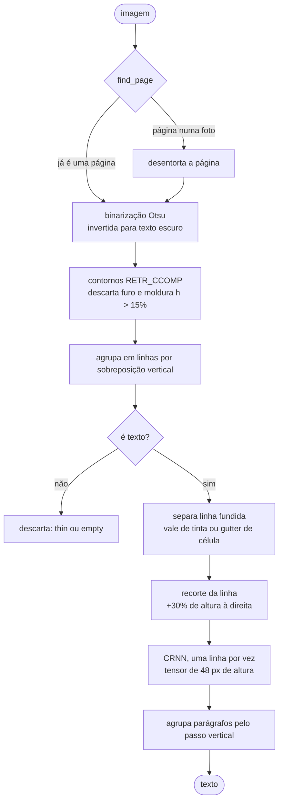
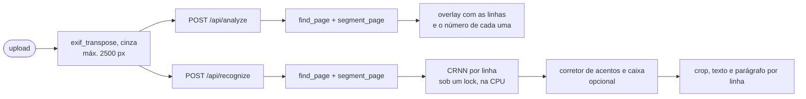
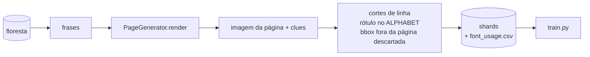

# Fluxo de dados

## Inferência: imagem → texto

Cada descarte tem um motivo, impresso por `python -m src.ocr.recognize <imagem> --debug`:
`frame`, `thin`, `empty`.

O `+30%` à direita existe porque o filtro de ruído do segmentador descarta o
blob do ponto final; sem ele a linha termina antes do ponto.

## Tela de depuração: upload → duas etapas

As duas rotas segmentam de novo em vez de receber as caixas do cliente, então o
servidor não guarda estado entre etapas. O modelo carrega uma vez no `lifespan`;
o nome vem da variável `OCR_CHECKPOINT`, que é obrigatória.

## Treino: corpus → pesos

O `font_usage.csv` guarda o `font_id` de cada amostra; sem ele o
`compare_font_errors.py` não consegue abrir o shard.

Um corte cuja bbox passa da borda da página é descartado: o Pillow preencheria
a área faltante com preto e o rótulo continuaria com o texto inteiro.

## Onde fica cada etapa

| etapa | arquivo |
|---|---|
| página na foto, binarização, contornos, filtros, linhas | `src/ocr/analyzer.py` |
| recorte da linha, CRNN, parágrafos, texto | `src/ocr/recognize.py` |
| corretor de acentos e caixa | `src/ocr/postprocess.py` |
| página sintética e cortes de treino | `src/datagen/` |
| tela de depuração | `src/web/app.py` |
| limiares medidos nos documentos reais | `src/ocr/analyzer.py` (topo do módulo) |
