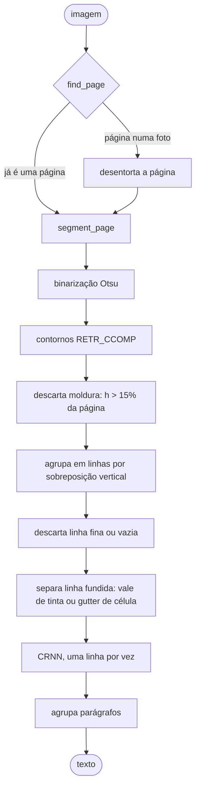
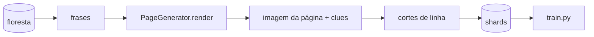

# Fluxo de dados

## Inferência: imagem → texto

Cada descarte tem um motivo, impresso por `python -m src.ocr.recognize <imagem> --debug`:
`frame`, `thin`, `empty`.

## Treino: corpus → pesos

## Onde fica cada etapa

| etapa | arquivo |
|---|---|
| página na foto, binarização, contornos, filtros, linhas | `src/ocr/analyzer.py` |
| recorte da linha, CRNN, parágrafos, texto | `src/ocr/recognize.py` |
| corretor de acentos e caixa | `src/ocr/postprocess.py` |
| página sintética e cortes de treino | `src/datagen/` |
| tela de depuração | `src/web/app.py` |
